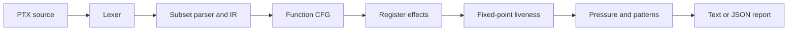

# PTXScope

PTXScope is a CPU-only static analyzer for a documented subset of NVIDIA PTX. It tokenizes and parses selected PTX assembly, forms function-local basic blocks, resolves direct branches, solves backward virtual-register liveness, estimates live-value pressure, and reports limitations. It does not assemble, execute, optimize, or allocate registers for GPU hardware.

PTX is NVIDIA's virtual instruction set between high-level CUDA code and target GPU machine code. Inspecting it can help explain compiler output, control flow, and where virtual values remain live. PTXScope exposes those structures without requiring a CUDA Toolkit or GPU.

## Scope

- C++20, CMake, CTest, and a dependency-free test harness.
- Lexer with line/column locations, line and block comments, register tokens, literals, directives, and punctuation.
- Subset parser for function bodies, `.entry`, `.func`, `.version`, `.target`, `.address_size`, `.reg`, labels, instruction modifiers, guards, and structured operands.
- Function-local CFGs with direct `bra` target resolution, conditional fall-through, termination, and reachability.
- Register effects for the opcode families listed in [the subset guide](docs/supported-ptx-subset.md).
- Fixed-point block liveness and instruction live-in/live-out sets. Predicated destinations are conservatively read and written.
- Peak live-value estimate at instruction boundaries, split into GPR-like, predicate, and selected special-register classes.
- Stable diagnostic codes and deterministic text/JSON reports.

Unknown instructions are retained but make effects incomplete. Unsupported directives are warned about. A valid parse means accepted by this subset, not accepted by `ptxas`.

## Build and run

Requirements: CMake 3.20+, a C++20 compiler, and Make. Python 3 is optional for the CLI integration test. The included presets use `clang++`; change `CMAKE_CXX_COMPILER` in a local preset or configure directly if you prefer another C++20 compiler.

```sh
cmake --preset default
cmake --build --preset default
ctest --preset default

./build-default/ptxscope analyze examples/vector_add.ptx --cfg --liveness --pressure
./build-default/ptxscope analyze examples/loop_kernel.ptx --verbose
./build-default/ptxscope analyze examples/vector_add.ptx --format json --output report.json
./build-default/ptxscope analyze examples/vector_add.ptx --format json --timings
./build-default/ptxscope analyze examples/vector_add.ptx --function vector_add --diagnostics-only
./build-default/ptxscope help
./build-default/ptxscope version
```

The `--cfg`, `--liveness`, and `--pressure` flags are accepted for readability; the standard report includes all three summaries. `--verbose` adds block and per-instruction live sets. `--diagnostics-only` emits only diagnostics in text format. JSON stdout contains only JSON. `--timings` adds nondeterministic phase timings to JSON (off by default to keep ordinary reports deterministic). `--strict` returns an analysis error for warnings or incomplete effects.

Exit codes: `0` success (warnings may be present), `2` CLI usage, `3` input/parse failure, `4` semantic analysis error or strict-mode finding, `5` output failure.

## Example input

```ptx
.version 7.0
.target sm_70
.entry add_one() {
    .reg .b32 %r0, %r1;
    mov.u32 %r0, 1;
    add.u32 %r1, %r0, 1;
    ret;
}
```

Text reports include function instruction/block/edge counts, declared virtual registers, solver convergence, effect completeness, a peak pressure estimate, and source-located diagnostics. JSON has `schema_version: 1` and stable sorted diagnostic/register-set ordering. Fields include per-function counts, CFG block predecessors/successors, block USE/DEF/IN/OUT sets, instruction liveness, pressure split, and diagnostic locations. Example JSON is generated by the CLI rather than maintained as a fabricated static result:

```sh
./build-default/ptxscope analyze examples/vector_add.ptx --format json
```

For `examples/loop_kernel.ptx`, the observed text summary includes:

```text
Function count_loop [entry]
  Instructions: 5
  Basic blocks: 3, edges: 3, unreachable: 0
  Liveness: converged in 3 iterations; effects modeled for this subset
  Peak simultaneously live estimate at instruction 2: GPR-like=2, predicate=1, other=0
```

The corresponding JSON shape (excerpt from the CLI output) is:

```json
{"schema_version":1,"input":"examples/loop_kernel.ptx","ptx_version":"7.0","target":"sm_70","parse_valid":true,"functions":[{"name":"count_loop","instruction_count":5,"basic_block_count":3,"edge_count":3,"liveness_converged":true,"effects_complete":true,"peak_pressure":{"instruction":2,"gpr_like":2,"predicate":1,"other":0}}],"diagnostics":[]}
```

## How to read the analyses

For each block, `USE` contains registers read before any definition in that block; `DEF` contains supported writes. Backward data flow solves `OUT[B] = union(IN[successors])` and `IN[B] = USE[B] union (OUT[B] - DEF[B])` until sets stop changing. The solver iterates over cycles, so loop-carried values are represented. Instruction sets are then computed with a reverse walk.

The pressure summary counts the union of live-in and live-out virtual registers at each instruction boundary and reports the boundary with the largest combined count, split by modeled register category. This conservative estimate is not physical register allocation. PTXAS allocation, spills, occupancy, and runtime also depend on compiler decisions, GPU architecture, launch configuration, and other hardware resources.

## Architecture



See [architecture](docs/architecture.md), [parsing design](docs/parsing-design.md), [control-flow analysis](docs/control-flow-analysis.md), [liveness](docs/liveness-analysis.md), and [register pressure](docs/register-pressure.md).

## Validation

```sh
ctest --test-dir build-default --output-on-failure
./scripts/run_all_tests.sh build-default
./scripts/run_sanitizers.sh
./scripts/validate_with_cuda.sh build-default/ptxscope
```

The CUDA validation script detects `nvcc` and `ptxas`, reports versions, and skips if they are missing. No CUDA compiler or GPU is required for ordinary builds/tests. See [validation notes](docs/validation.md). Benchmark instructions and actual run records are in [benchmarks/README.md](benchmarks/README.md); no throughput or GPU-performance claim is made.

## Limitations and future work

PTX syntax and semantics are extensive and versioned. The parser does not implement all grammar forms, function parameter semantics, address-space memory behavior, interprocedural calls, indirect/indexed branches, or arbitrary instruction effect rules. Operand types are retained as modifiers rather than fully type-checked. Branches to missing or end-of-function labels are errors. Unknown effects and unsupported control flow reduce confidence and are called out in diagnostics.

Useful next steps are a formally specified grammar with structured function parameters; broader instruction effects verified against the official ISA; memory/call-aware analysis and richer differential tests against `ptxas` when available.

## License

MIT. See [LICENSE](LICENSE). PTXScope is an independent project and is not affiliated with NVIDIA.
