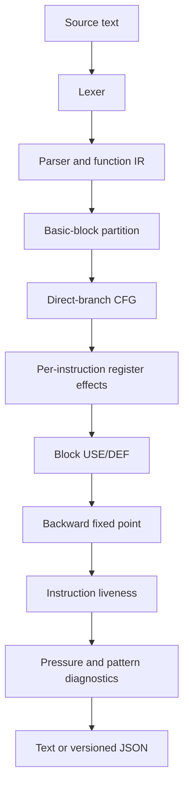

# Architecture

The implementation uses small stages and stable vectors for source order. The analyzer does not execute PTX.

`model.hpp` contains source locations, diagnostics, tokens, structured operands, instructions, declarations, functions, blocks, and result types. `lexer.cpp` only handles token boundaries. `parser.cpp` builds the accepted subset IR. `analysis.cpp` builds CFG and effect/liveness/pressure data. `report.cpp` serializes stable text and JSON. The CLI owns file I/O and exit-code policy.

All control-flow and liveness are intraprocedural. Function IDs, instruction positions, and block IDs follow source order. Ordered sets keep register and diagnostic output deterministic.
