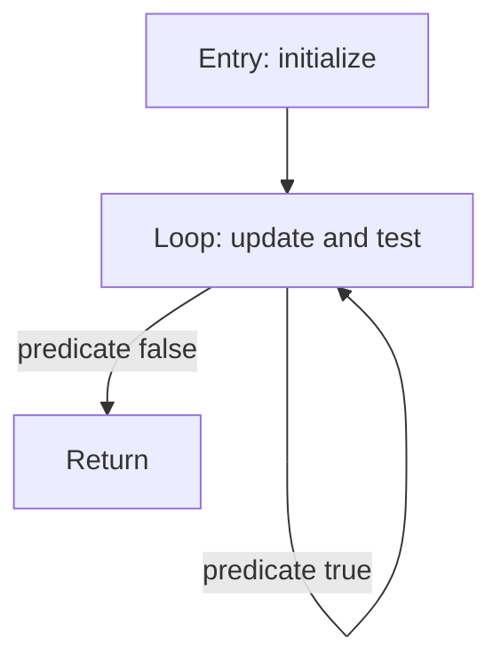

# Control-flow analysis

Each function receives an independent graph. Entry, labels, and instructions following terminators define block boundaries. A direct `bra label` contributes its target edge; a guarded branch also contributes fall-through. `ret`, `exit`, and `trap` terminate a block without fall-through. Other instructions fall through to the next block.

Labels are resolved only in their function. Duplicate labels and unresolved targets are errors; a label at the very end does not create an empty target block. Reachability starts at block zero. `brx` is diagnosed as unsupported control flow and makes dependent results incomplete. Calls are not explicitly modeled as branches to another function; interprocedural effects are outside scope.

For a branch diamond, each arm has an edge to the join; loops create backward edges. The current tests assert a loop's predecessor/successor relations and solver convergence. No dominator, natural-loop, or irreducibility claim is made.

